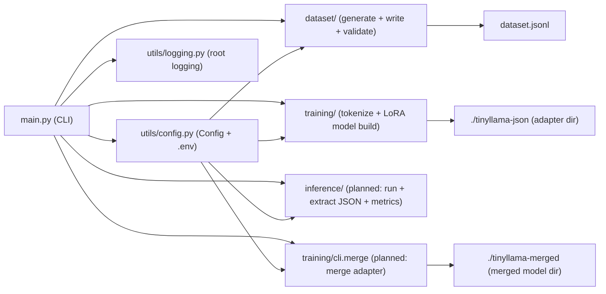

# Architecture

This project is structured as a small CLI-driven pipeline with four intended stages: dataset generation, training, inference/validation, and merging.

## High-level diagram

## Modules and responsibilities

### `main.py` (CLI entrypoint)

- Parses CLI arguments and subcommands.
- Loads configuration via `utils/config.py`.
- Configures logging via `utils/logging.py`.
- Delegates to module-specific CLI adapters:
  - `dataset/cli.py`
  - `training/cli.py`
  - `inference/cli.py`

### `utils/` (cross-cutting infrastructure)

- `utils/config.py`
  - Central `Config` dataclass.
  - Loads values from a `.env` file (default: `.env`) and environment variables.
  - Selects the compute device via `utils/device.detect_device()` unless `DEVICE` is set.
- `utils/device.py`
  - Detects `cuda` / `mps` / `cpu`.
  - Provides device-specific defaults (batch size, fp16 recommendation).
- `utils/logging.py`
  - Sets up a consistent root logger for all commands.

### `dataset/` (synthetic data)

- `generator.py`
  - Generates synthetic math and “generic knowledge” examples.
  - Formats each sample as:
    - `### Instruction:` (an instruction to respond with JSON)
    - `### Input:` (the question)
    - `### Response:` (the target JSON object)
- `writer.py`
  - Writes samples as JSONL (`{"text": "...formatted prompt..."}`).
  - Validates that the embedded JSON inside `### Response:` is parseable and contains required keys.
- `cli.py`
  - Glue code for `generate-dataset`.

### `training/` (model preparation)

**Note:** the top-level training command is currently a placeholder in `training/cli.py`, but the building blocks exist:

- `data_loader.py`
  - Loads JSONL via HuggingFace `datasets`.
  - Tokenizes with padding/truncation and creates labels for causal LM.
- `model_loader.py`
  - Loads tokenizer and base model (`transformers`).
  - Applies LoRA via `peft` with a fixed configuration (r/alpha/modules/dropout).

### `inference/` (planned validation stage)

`inference/cli.py` is currently a placeholder. The intended responsibilities are:

- Load base model + adapter.
- Generate outputs for a set of questions.
- Extract JSON from model output.
- Compute validity and other evaluation metrics.

## Data flow

1. `generate-dataset` produces `dataset.jsonl`.
2. `train` loads and tokenizes `dataset.jsonl`, builds base model + LoRA adapter, trains, and writes adapter artifacts.
3. `test` runs inference and validates JSON output.
4. `merge` merges adapter weights into the base model and saves a standalone model directory.

## Design decisions (brief)

- **Single shared Config** keeps CLI and modules consistent.
- **Synthetic dataset** makes the project self-contained and reproducible.
- **LoRA** reduces training memory/time compared to full fine-tuning.
- **Strict JSON target schema** simplifies downstream consumption and evaluation.

